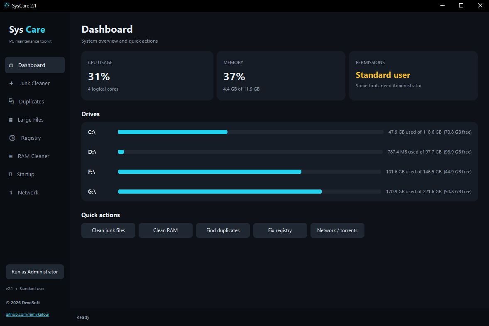
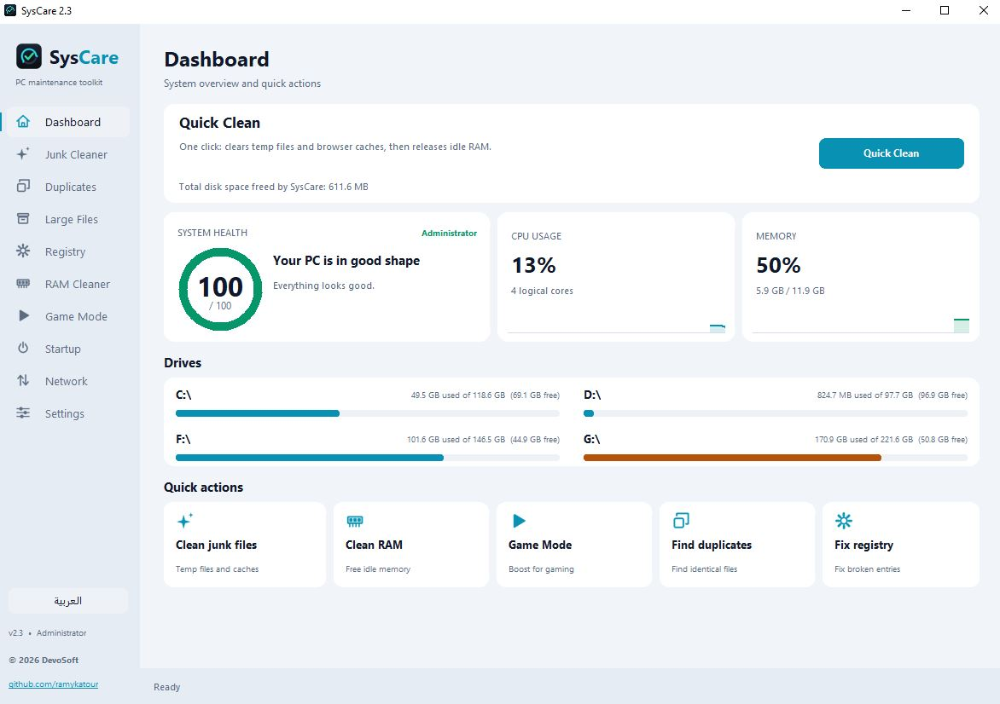

  

<h1 align="center">SysCare</h1>

  A small maintenance toolkit for Windows 10 and 11. 
  Junk cleaner, RAM cleaner, game mode, duplicate finder, registry fixer, startup manager and a network monitor in one window. English and Arabic.

  <a href="https://github.com/ramykatour/SysCare/releases/latest"><b>Download SysCare.exe</b></a> ·
  <a href="https://github.com/ramykatour/SysCare/issues">Report a bug</a>

  
  
  

<!-- Screenshots go in docs/screenshots/ -->

  
  

## What it does

**Quick Clean** is the button on the dashboard. One click clears temp files and browser caches, then releases idle RAM, and shows what was freed. It does not touch the Recycle Bin or your documents. There is a "Copy result" button if you want to share the numbers.

**The dashboard** also shows a System Health score from 0 to 100. It is based on how full your drives are, how much memory is in use, how many programs start with Windows and whether a torrent client is running. The biggest problems are listed under the score, and "Fix now" opens the page that deals with the first one. CPU and memory have a one-minute history graph, and each drive bar turns amber above 70% and red above 90%. The quick action tiles jump straight to the cleaner tools.

**Junk Cleaner** clears temp files, the thumbnail cache, Windows error reports, the Windows Update download cache, Chrome / Edge / Firefox caches and the Recycle Bin. It shows the size of each category before you delete anything.

**RAM Cleaner** asks Windows to release idle memory from running processes and tells you how much came back. There is an option to flush the standby cache as well (needs Administrator). Below that is a list of the 40 biggest memory users, and you can end any of them from there.

**Game Mode** lists background apps that are usually safe to close before playing (OneDrive, Teams, Skype, Dropbox, Adobe helpers and similar, plus any torrent client), closes the ones you leave checked, frees RAM and can switch Windows to the High performance power plan. Stop Game Mode puts the power plan back.

**Duplicate Finder** matches files by size first, then a partial hash, then a full SHA-256. You pick which copy to keep (oldest, newest or shortest path). It will not let you delete every copy in a group.

**Large Files** lists the biggest files in a folder you choose.

**Registry Fixer** looks for broken startup entries, orphaned uninstall entries and dead App Paths. Before it touches anything it writes a `.reg` backup, and if the backup fails that item is skipped. Backups can be restored from inside the app. It can also create a restore point first.

**Startup Manager** enables or disables startup programs the same way Task Manager does, so nothing is deleted. Torrent clients are highlighted.

**Network Monitor** shows live download and upload speed and which processes hold the most connections. Torrent clients are flagged and can be ended from the list.

**Settings** has the theme (dark or light) and accent color, the language switch (English / Arabic), the update check, tray options and automatic cleaning.

### Tray and automatic cleaning

SysCare can stay in the system tray after you close the window, with a menu for Quick Clean and Clean RAM. In Settings you can also:

- start SysCare with Windows, minimized to the tray (done with a scheduled task, because the exe needs Administrator);
- clean RAM automatically when usage goes above a level you choose (60 to 95 percent);
- run Quick Clean daily or weekly.

Automatic cleaning only runs while SysCare is open or in the tray.

## How it handles your files

- Duplicate Finder and Large Files send files to the Recycle Bin instead of deleting them.
- Registry fixes are backed up to `Documents\SysCare\RegistryBackups` first.
- Only clear-cut registry problems are listed. There is no "optimize" button.
- The scanners skip `Windows`, `Program Files`, `ProgramData` and `AppData`.
- Anything destructive asks for confirmation. Automatic cleaning and the tray menu only run things you turned on yourself.

## Privacy

No ads, no telemetry, no accounts and no bundled software. Everything runs locally.

SysCare makes exactly one network request: an optional update check to `api.github.com` when it starts, which only reads the latest release number. You can turn it off in Settings. Settings are stored in `%APPDATA%\SysCare\config.json`.

Two things worth knowing. Cleaning the registry almost never speeds up a PC, so treat it as a way to remove leftovers. And the RAM Cleaner gives you free memory for a short while: Windows reloads pages as programs need them, so it is mainly useful when memory is close to full. If usage is always high, the list of top processes will tell you more than the cleaner will.

## Download and install

1. Go to the [Releases](https://github.com/ramykatour/SysCare/releases/latest) page and download `SysCare.exe`.
2. Run it. There is no installer. SysCare only writes its settings file and the registry backups mentioned above, plus a startup task if you turn on "Start with Windows".
3. Accept the Administrator prompt. It is needed for the Windows Temp folder, the Update cache, the standby cache and HKLM registry entries. Without it SysCare still runs, but those items are skipped.

Requirements: Windows 10 or 11, 64-bit.

<!-- TODO after building 2.3: upload SysCare.exe to VirusTotal and replace this link and the numbers below -->
VirusTotal report: [view scan](https://www.virustotal.com/gui/file/160ced026df2b0886741059b5f0ba083721cfd6f44692b3ef050b96ccb4d3217/detection)

### Windows SmartScreen

On first launch Windows may show "Windows protected your PC", because the exe is not signed with a paid code-signing certificate. Click **More info**, then **Run anyway**.

### Antivirus warnings

A few engines flag programs that edit the registry, touch process memory, create scheduled tasks and ask for admin rights, and SysCare does all of that. In the VirusTotal scan of version 2.1, 3 of 71 engines (Bkav Pro, CrowdStrike Falcon and SecureAge) returned generic heuristic detections, and the major engines did not flag it. This is common for PyInstaller builds. You can [check the current report](https://www.virustotal.com/gui/file/5af1ec346f68285d5130ac57b11d49e86503eb959073f5fb9316b5b46e932282/detection) yourself. If you are not comfortable running it, don't.

## FAQ

**Can the RAM Cleaner make me lose unsaved work?**
No. It does not close anything. Only the "End checked processes" button does, and it asks first.

**It freed almost nothing.**
That usually means there was little idle memory to release. Look at the process list to see what is actually using it.

**Does Quick Clean delete my files?**
It deletes temp files and browser caches only. Documents, downloads, the Recycle Bin and the Windows Update cache are left alone.

**Is Game Mode safe?**
It only ends the apps you leave checked, and it asks first. Anything unsaved in those apps is lost, and they start again the next time you open them or restart Windows. The power plan is restored when you press Stop Game Mode or close SysCare.

**Can I use light mode or change the color?**
Yes. Open Settings, then Appearance. Pick Dark or Light and one of four accent colors. It applies immediately and is remembered.

**What does the health score mean?**
It is a quick hint, not a diagnosis. It goes down when a drive is almost full, memory is nearly used up, many programs start with Windows or a torrent client is running. If it says everything looks good, there is nothing obvious to fix.

**How do I use it in Arabic?**
Press the language button at the bottom of the sidebar, or choose it in Settings. The text is translated but the layout is not mirrored.

**How do I undo a registry fix?**
Registry Fixer, then "Restore from backup...", then pick the `.reg` file. Double-clicking the file in Explorer works too.

**My internet is slow.**
Open the Network page. A running torrent client shows up in red. End it there and disable it in Startup Manager so it stays off.

**Why do some items say they need Administrator?**
Windows Temp, the Update cache, the standby cache and HKLM entries are protected. Run SysCare as Administrator to include them.

**How do I uninstall it?**
Turn off "Start with Windows" in Settings if you enabled it, then delete `SysCare.exe`. Registry backups stay in `Documents\SysCare` and settings in `%APPDATA%\SysCare` until you remove those folders.

## Feedback

Found a bug or want a feature? [Open an issue](https://github.com/ramykatour/SysCare/issues) and include your Windows version and what you clicked.

## License

SysCare is free to use for personal and commercial use. The software is provided as is, without warranty. Redistribution of modified copies or reverse engineering is not permitted without written permission.

© 2026 [DevoSoft](https://github.com/ramykatour). Keep backups of anything important.